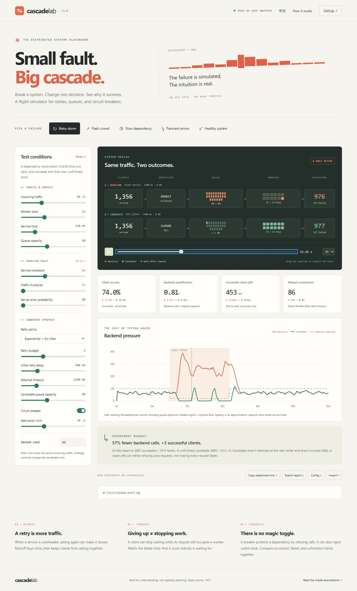

<p align="center"></p>
<h1 align="center">Cascade Lab</h1>
<p align="center"><strong>Small fault. Big cascade.</strong><br>A flight simulator for retries, queues, and circuit breakers.</p>
<p align="center"><a href="https://xiaoyouxian07-cpu.github.io/cascade-lab/">Live playground</a> · <a href="README.zh-CN.md">简体中文</a> · <a href="docs/model.md">How the model works</a> · <a href="docs/experiments.md">Try an experiment</a></p>

Your dependency slows down. Clients time out. They retry. The old requests are **still running**. Now your recovery traffic is the outage.

Cascade Lab lets you see that feedback loop, then change the decisions that created it. Run the same traffic against two strategies, rewind the fault, and compare what happened to **clients**, not just server load.



## Try it in 30 seconds

```sh
git clone https://github.com/xiaoyouxian07-cpu/cascade-lab.git
cd cascade-lab
npm start
```

Open **http://127.0.0.1:4173**. Node.js 20+; no installation step, API key, backend, or runtime dependencies. A modern browser with ES modules and Web Workers is required. Serve the files over HTTP rather than opening `index.html` directly.

1. Start with **Retry storm**.
2. Drag the replay to **21 seconds**. Compare the queues and occupied workers.
3. Turn the candidate's **circuit breaker off**. Watch backend pressure change.
4. Try **Transient errors**. This time, retries help more clients succeed.
5. Export a report, or copy a link so someone else can reproduce the exact experiment.

## What you can explore

- **Five scenarios:** retry storm, flash crowd, slow dependency, transient errors, and a healthy control.
- **Real tradeoffs:** no retries, fixed delay, exponential backoff, and full jitter; bounded queues, attempt deadlines, a token-bucket limiter, and a circuit breaker.
- **Paired experiments:** both browser runs receive identical arrival times. A job's service variation is keyed by seed, job ID, and attempt number.
- **Time travel:** replay or scrub a 60-second experiment, including work that continues after a client gives up.
- **Honest accounting:** successful, failed, and unfinished clients; successful-client p95; backend amplification; wasted completions.
- **Reproducible sharing:** URL-fragment configs, JSON import/export, Markdown reports, and the same engine in a CLI.
- **English and Chinese UI**, keyboard-operable controls, responsive layouts, no remote fonts or analytics.

The simulation never calls a target service. Experiment data stays in memory. The app fetches only its own static files; a hosted page still involves ordinary requests to its hosting provider. Share links contain only simulation settings, not real captures or credentials.

## A result, not a promise

Default `retry-storm`, model 1.0.0, seed 42, 60 seconds:

| Metric | Baseline | Candidate |
| --- | ---: | ---: |
| Successful clients | 2,887 | 2,890 |
| Failed clients | 1,015 | 1,012 |
| Unfinished clients | 6 | 6 |
| Backend calls / original requests | 1.87× | 0.81× |
| Successful-client p95 | 1,231 ms | 453 ms |
| Work completed after client timeout | 360 | 86 |

The candidate reduces backend calls substantially but barely changes success count. That is a tradeoff to inspect, not a universal recommendation. **p95 includes successes only**, so refusing slow requests can lower it. Exact results depend on the model version, configuration, and seed.

## CLI and JavaScript API

```sh
node bin/cascade.js --scenario retry-storm --compare
node bin/cascade.js --scenario transient-errors --compare --seed 7
node bin/cascade.js --compare --format markdown > report.md
node bin/cascade.js --compare --format json > result.json
node bin/cascade.js --config examples/baseline.json --candidate examples/candidate.json
node bin/cascade.js --help
```

`--config` and `--candidate` take **plain engine config objects**. Browser exports wrap these in `{version, scenario, config, overrides}`; extract `config` and `overrides` when using those files in the CLI. With `--compare`, the selected scenario's candidate overrides are used unless `--candidate` is supplied.

```js
import { simulate, compare } from './src/engine.js';

const run = simulate({ seed: 42, arrivalRate: 65 });
const experiment = compare(run.config, { policy: 'jitter', breaker: true });
console.log(experiment.candidate.summary);
```

The browser fixes the incoming workload across runs. The lower-level API deliberately allows arbitrary overrides; callers doing paired comparisons should preserve workload settings. Model documentation lists every setting, its units, and the accounting rules.

## Develop and deploy

```sh
npm test       # Node's built-in test runner; no dependencies
npm run build  # Static output in dist/
npm start      # Loopback-only development server
```

Serve `dist/` on any static host. All asset paths are relative, including the worker module, so repository subpaths work. The included GitHub Pages workflow builds and deploys when **Settings → Pages → Source** is set to **GitHub Actions**. The CI workflow checks Node 20, 22, and 24.

```text
src/engine.js    deterministic model, validation, reports
src/presets.js   reproducible scenarios
src/worker.js    browser worker boundary
app.js          interface and replay
bin/cascade.js  command-line adapter
test/           behavior, invariants, and CLI tests
docs/           model, experiments, roadmap, launch materials
```

## What this is not

This is an educational queueing model, **not a load-testing tool or a capacity forecast**. It models one dependency, one retry layer, and one shared breaker. It does not model CPU contention, TCP, distributed client breakers, idempotency, or actual network requests. The time step is 25 ms; actions round up to a step. See [the complete assumptions](docs/model.md).

Inspired by the mechanisms described in the [AWS Builders’ Library](https://aws.amazon.com/builders-library/timeouts-retries-and-backoff-with-jitter/) and [Exponential Backoff and Jitter](https://aws.amazon.com/blogs/architecture/exponential-backoff-and-jitter/). This is an independent implementation and is not affiliated with AWS.

## Contributing

Useful contributions include a counterexample to a model assumption, a better experiment, a failing invariant test, an accessibility fix, or a translation. Start with [CONTRIBUTING.md](CONTRIBUTING.md) and [the roadmap](docs/roadmap.md). When reporting a behavior, attach the **experiment config and seed** so it can be reproduced.

MIT licensed. If the playground helped you explain an incident or teach a concept, a star helps others find it.
