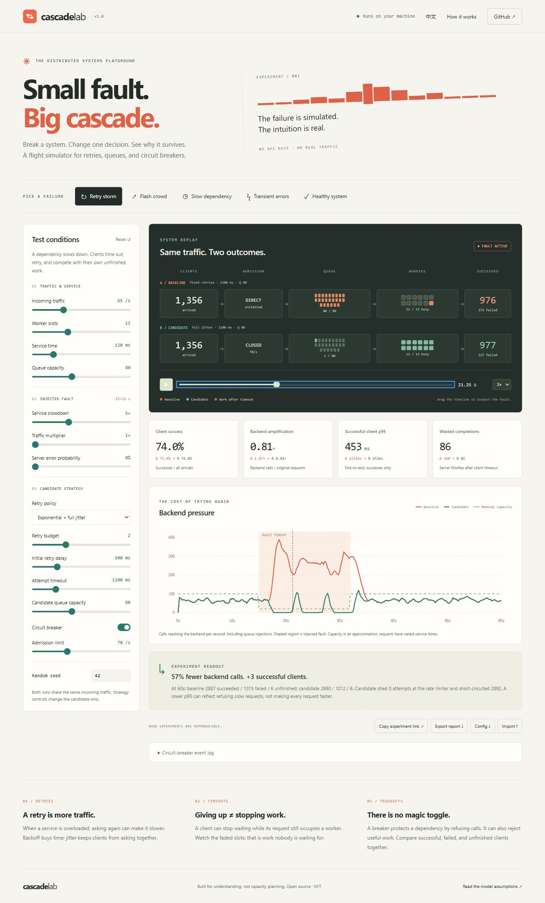

# Cascade Lab · 故障级联实验室

**小小故障，层层失控。亲手理解重试、队列、限流与熔断。**

[立即运行](#立即运行) · [English](README.md) · [模型说明](docs/model.md)

依赖突然变慢，客户端开始超时、重试。但客户端不等了，不代表服务器停止处理旧请求。于是恢复流量本身，也成了故障的一部分。

Cascade Lab 将这个过程变成可操作、可回放的实验：给两套策略输入相同的流量，观察请求如何排队、超时、放大，以及恢复。没有 API 密钥，没有真实压测流量，没有运行时依赖。



## 立即运行

需要 Node.js 20 或更新版本，无需 `npm install`。

```sh
git clone https://github.com/xiaoyouxian07-cpu/cascade-lab.git
cd cascade-lab
npm start
```

打开 **http://127.0.0.1:4173**，右上角切换中文。请通过本地 HTTP 服务访问，直接双击 HTML 无法加载模块和计算线程。

## 第一个实验

1. 选择「重试风暴」，把回放拖到第 21 秒。
2. 比较两个方案的等待队列与工作线程。条纹色块是客户端已经放弃、服务器还在处理的工作。
3. 关闭候选方案的熔断器，看看后端请求曲线如何变化。
4. 切换到「瞬时错误」，观察重试带来的收益。
5. 复制实验链接，或导出 JSON 参数与 Markdown 报告。

本地分享链接需要接收方也运行本地服务；跨设备分享建议使用在线演示链接，或导出参数文件。

## 已实现

- 五个场景：重试风暴、突发流量、慢依赖、瞬时错误、健康系统。
- 四种重试策略：不重试、固定间隔、指数退避、指数退避加全抖动。
- 有界 FIFO 队列、固定工作线程池、尝试超时、令牌桶限流、闭合/断开/半开熔断状态机。
- 固定随机种子的可复现实验，浏览器两次实验共享原始到达流量。
- 时间线回放、失败/未完成统计、成功客户端 p95、后端请求放大倍数和无效完成数。
- 英文与中文界面、移动端布局、键盘操作、Web Worker 计算。
- 参数链接、JSON 导入导出、Markdown 报告、零依赖命令行和自动化测试。

默认实验的候选方案将后端请求放大从约 **1.87× 降至 0.81×**，但成功客户端只从 **2,887 增加到 2,890**。项目会如实展示这类取舍。成功请求的 p95 下降，也不代表每个用户的体验都改善了。

## 命令行

```sh
npm run demo
node bin/cascade.js --scenario transient-errors --compare --seed 7
node bin/cascade.js --compare --format markdown > report.md
node bin/cascade.js --compare --format json > result.json
npm test
npm run build
```

`--config` 与 `--candidate` 接受原始引擎参数对象；浏览器导出的文件带有一层实验包装，需要分别取出 `config` 与 `overrides`。构建产物位于 `dist/`，可部署到任意静态托管服务。GitHub Pages 的工作流已包含在项目中，需要将仓库 Pages 来源设为 GitHub Actions。

## 模型边界

这是帮助建立直觉的教学模型，不是生产环境容量规划工具。时间步长为 25 ms，只有一个依赖、一层重试和一个共享熔断器；没有模拟网络时延、CPU 竞争、分布式熔断、幂等性或真实请求。观察窗口结束时仍在等待的请求单列为「未完成」。

欢迎贡献实验、反例、模型测试、翻译或无障碍修复。问题反馈请附参数和随机种子。采用 MIT 许可证。
